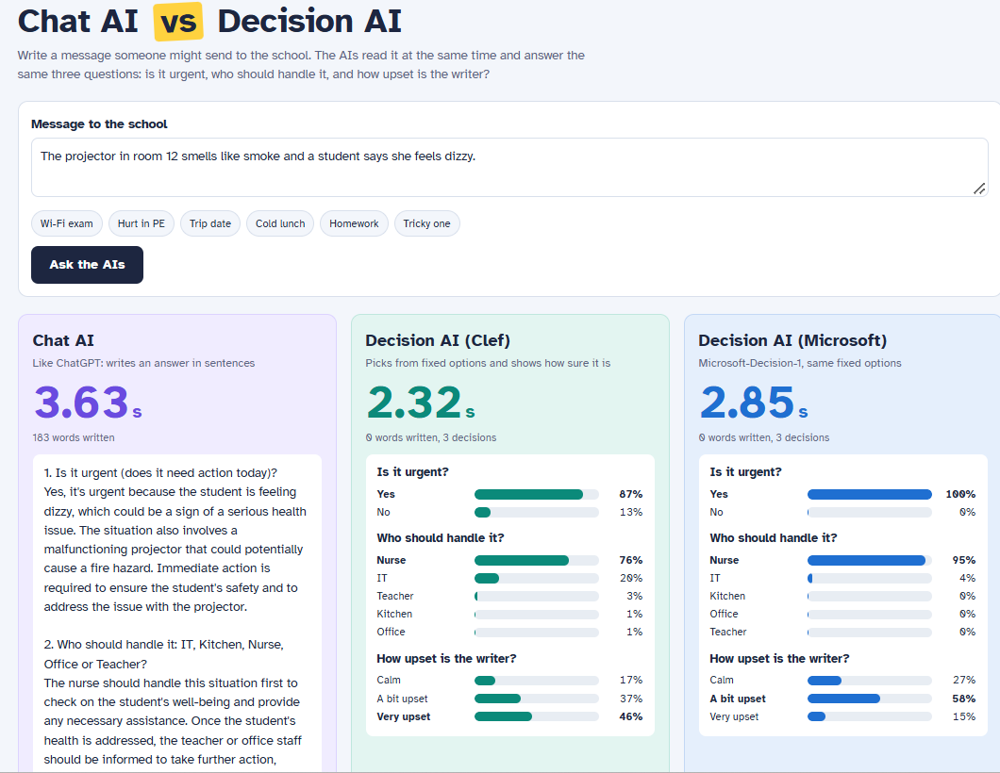

# Chat AI vs Decision AI

A small side-by-side demo that sends the same message, at the same time, to a **conventional chat model** and to two **decision models**: Cloudflare's **Clef** and **Microsoft-Decision-1**. It shows how each one answers, how fast, and how confident it is.



## Why

Most people think of AI as a chatbot that writes text. Decision models work differently: they receive a situation and a set of fixed questions, and return a probability for each allowed answer, without generating any text.

This demo makes that difference visible. A message (in the examples, a message sent to a school) is analysed by all models with the same three questions:

1. **Is it urgent?** (yes / no)
2. **Who should handle it?** (IT, Kitchen, Nurse, Office or Teacher)
3. **How upset is the sender?** (calm, a bit upset, very upset)

The chat model answers in sentences. The decision models answer with percentages. A stopwatch on each side shows how long each one takes.

| Lane | Model | Platform | Required |
|---|---|---|---|
| Chat AI | `@cf/meta/llama-3.1-8b-instruct` | Cloudflare Workers AI | Yes |
| Decision AI (Clef) | `@cf/cloudflare/clef-flash` | Cloudflare Workers AI | Yes |
| Decision AI (Microsoft) | `Microsoft-Decision-1` | Microsoft Foundry (your Azure subscription) | Optional |

## Requirements

- Python 3.8 or newer (no extra packages needed)
- A Cloudflare account (the free plan is enough), with your **account ID** and an **API token** with Workers AI permission
- Optional: an Azure subscription with access to Microsoft Foundry, to enable the Microsoft lane

## Setup

### 1. Cloudflare (required)

- **Account ID:** shown in the Cloudflare dashboard, on the Workers AI page or the account overview.
- **API token:** in the Cloudflare dashboard, go to *My Profile → API Tokens → Create Token* and use the *Workers AI* template.

### 2. Microsoft-Decision-1 (optional)

1. Open the [Foundry portal](https://ai.azure.com) and go to your project.
2. Select **Model catalog**, search for **Microsoft-Decision-1**, and select **Deploy**.
3. On the deployment details page, copy the **resource endpoint**, the **deployment name** and the **API key**.

Use only the base address of the resource as the endpoint, for example `https://my-resource.services.ai.azure.com`, with nothing after it. The script adds the API path itself. A longer address (for example, one ending in `/api/projects/...` or `/openai/v1`) returns a `404` error.

If these values are not set, the demo simply shows the chat model and Clef.

### 3. Set the environment variables

Windows (PowerShell):

```powershell
$env:CLOUDFLARE_ACCOUNT_ID="your-account-id"
$env:CLOUDFLARE_API_TOKEN="your-token"

# Optional: Microsoft-Decision-1
$env:AZURE_ENDPOINT="https://your-resource-endpoint"
$env:AZURE_DEPLOYMENT_NAME="your-deployment-name"
$env:AZURE_API_KEY="your-azure-key"
```

macOS / Linux:

```bash
export CLOUDFLARE_ACCOUNT_ID="your-account-id"
export CLOUDFLARE_API_TOKEN="your-token"

# Optional: Microsoft-Decision-1
export AZURE_ENDPOINT="https://your-resource-endpoint"
export AZURE_DEPLOYMENT_NAME="your-deployment-name"
export AZURE_API_KEY="your-azure-key"
```

### 4. Run it

```bash
python clef_demo.py
```

The terminal shows whether Microsoft-Decision-1 is enabled. Then open [http://localhost:8787](http://localhost:8787) in your browser. Press `Ctrl+C` in the terminal to stop it.

## How it works

The script starts a small local web server that serves the page and forwards each request to the right API. All models are called in parallel.

**Chat model:** receives a system prompt with the three questions and the user's message, and writes a free-text answer.

**Decision models:** Clef and Microsoft-Decision-1 use the same request format. Both receive the message as `state` and exactly the same three questions:

```python
"questions": {
    "urgent": {"type": "noul", "instructions": "Is this message urgent?"},
    "team":   {"type": "choice", "instructions": "Who should handle it?", "criteria": TEAMS},
    "mood":   {"type": "score", "instructions": "How upset is the sender?", "criteria": MOODS},
}
```

- `noul` returns the probability of "yes"
- `choice` returns a probability for each option
- `score` returns a probability for each level of the scale

| | Clef | Microsoft-Decision-1 |
|---|---|---|
| Endpoint | Cloudflare REST API, `/ai/run/@cf/cloudflare/clef-flash` | `<your-endpoint>/providers/microsoft/v1/systemone` |
| Authentication | `Authorization: Bearer <token>` | `api-key: <key>` |
| `model` field | `clef-flash` | Your deployment name |

You can change the models, the questions and the options at the top of `clef_demo.py`. Set `CLEF_MODEL = "clef"` to use the larger Clef model instead of Clef-flash.

## Example results

These are small, informal tests: one message per run, from my own machine. They are illustrations, not benchmarks.

### Chat model vs Clef

Three runs with the same message (*"The school Wi-Fi hasn't worked all morning and we can't do the online exam!"*):

| Run | Chat model time | Chat model Neurons | Clef time | Clef Neurons |
|---|---|---|---|---|
| 1 | 4.93 s | 46.04 | 0.79 s | 3.35 |
| 2 | 9.64 s | 42.56 | 1.73 s | 3.35 |
| 3 | 3.83 s | 42.76 | 0.74 s | 3.35 |
| **Average** | **6.13 s** | **43.79** | **1.09 s** | **3.35** |

In this test, Clef was about **5.6x faster** and about **13x cheaper**. Its cost was identical in every run because it generates no text.

### Clef vs Microsoft-Decision-1

One run for each of the six example messages in the demo:

| Message | Clef time | Microsoft time | Urgent? | Who handles it? | How upset? |
|---|---|---|---|---|---|
| Wi-Fi exam | 0.58 s | 0.89 s | Both yes | Both IT | Clef: very · MS: a bit |
| Hurt in PE | 0.35 s | 0.64 s | Both yes | Both Nurse | Clef: very · MS: a bit |
| Trip date | 0.32 s | 0.67 s | Both no | Both Office | Both calm |
| Cold lunch | 1.00 s | 1.67 s | Both yes | Both Kitchen | Clef: very · MS: a bit |
| Homework | 1.48 s | 1.47 s | Both no | Both Teacher | Clef: a bit · MS: calm |
| Tricky one | 0.78 s | 1.15 s | Both yes | Both Nurse | Clef: very · MS: a bit |
| **Average** | **0.75 s** | **1.08 s** | | | |

Observations:

- **Same practical decisions.** Both models chose the same team and the same urgency in all six messages.
- **Different reading of emotions.** On "How upset is the sender?", they agreed only once. In the other five cases, Clef rated the sender one level more upset than Microsoft-Decision-1, every time. This is a subjective question with no single right answer.
- **Different confidence.** Microsoft-Decision-1 often returned 99–100% for its top option, while Clef spread its probabilities more. In the "Tricky one" message (a smoking projector and a dizzy student), Clef gave IT 20%, while Microsoft gave it 3%. Both chose the nurse.
- **Speed.** Clef was faster in five of the six runs. The two models run on different platforms (Cloudflare and Azure), so these times also include network and server differences.

## Limitations

- The results above come from very small tests and should not be used to rank the models.
- Decision models are cheaper and faster partly because they do less: they can only choose from the options you define, and they do not explain their reasoning. For conversation and explanation, chat models remain the right tool.
- Times include network latency and depend on your location, connection and each provider's servers.
- Models can change or be retired over time. If a chat model stops working, the script tries the next one in `CHAT_MODELS`.

## Cost

The demo uses your own accounts:

- **Cloudflare:** Workers AI includes a free daily allowance of Neurons. One comparison (chat model + Clef) used about 50 Neurons in total. Check your usage in the Cloudflare dashboard under *AI → Workers AI*.
- **Azure:** Microsoft-Decision-1 is billed to your Azure subscription per input token, with output free. One request is a tiny fraction of a cent. Check your costs in the Azure portal under *Cost Management → Cost analysis*. Costs can take several hours to appear.

## Security

- Never commit your API tokens, keys or account IDs. Use environment variables as shown above.
- If a token or key is ever exposed, revoke it immediately and create a new one.
- The local server only listens on `127.0.0.1`, so it is not reachable from other computers.

## License

MIT. See [LICENSE](LICENSE).

This is an independent project and is not affiliated with Cloudflare, Microsoft, Meta or TypeSafe.
